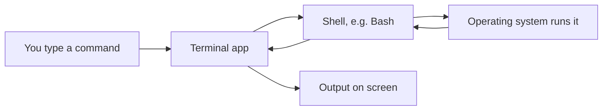

# Bash Fundamentals and the Command Line: Your Field Guide

The command line is the fastest way to talk to your computer, and nearly every developer tool is built around it. Each concept below follows the same breakdown: **What it is**, **The Everyday Analogy**, **Why it matters**, and a **Quick Example**. Every major section ends with a Production Pitfall or Dev Tip.

## Table of Contents

1. [Terminal vs Command Line vs Shell](#1-terminal-vs-command-line-vs-shell)
2. [Command Line Shortcuts](#2-command-line-shortcuts)
3. [Bash and Basic Commands](#3-bash-and-basic-commands)
   - [Navigation](#filesystem-navigation) | [Viewing files](#viewing-file-contents) | [File management](#file-management) | [echo and redirection](#echo-and-redirection) | [Finding and help](#finding-things-and-getting-help)
4. [Command Options and Flags](#4-command-options-and-flags)
5. [Configuring Your Keyboard Layout](#5-configuring-your-keyboard-layout)
6. [Cheat Sheet](#6-cheat-sheet)
7. [Quick Check](#7-quick-check)

---

## 1. Terminal vs Command Line vs Shell

### What it is

Three terms that people use interchangeably, but which mean different things:

- **Command line:** A basic text interface where you type a **command** and press **Enter** to run it.
- **Terminal:** The **application** that gives you a command line, so you can run system-level commands. A **terminal emulator** is a terminal with extra features wrapped around it (tabs, themes, split panes).
- **Shell:** The **software that interprets** what you type as commands and returns the output. **Bash** is a shell.

### The Everyday Analogy

Ordering food at a restaurant counter:

- The **terminal** is the **counter window** you walk up to.
- The **command line** is the **order slip** you write on.
- The **shell** is the **waiter** who understands your order and brings back the result.

### Why it matters

- You will see these words constantly in docs, tutorials, and error messages, and knowing the difference saves confusion.
- You can swap one part without changing the others (same shell, different terminal app).
- Most dev tools (Git, Node, Docker, PostgreSQL) are driven from here.

### Quick Example: How the Pieces Fit



### How to Open a Terminal on Your System

| OS          | Built-in options                                                                                                                                                                                                                                 | Popular alternatives                                                   |
| ----------- | ------------------------------------------------------------------------------------------------------------------------------------------------------------------------------------------------------------------------------------------------ | ---------------------------------------------------------------------- |
| **Windows** | **PowerShell** and **Command Prompt** (each is a shell with its own terminal app). **Windows Terminal** (from the Microsoft Store) is a modern emulator that hosts both, plus your Linux shell if you use **WSL** (Windows Subsystem for Linux). | WSL gives you a real Bash on Windows                                   |
| **macOS**   | **Terminal** (find it with Spotlight or the app launcher)                                                                                                                                                                                        | **iTerm**, **Ghostty**                                                 |
| **Linux**   | Depends on your distro and desktop environment                                                                                                                                                                                                   | **kitty** and many others, usually installed with your package manager |

> **Dev Tip:** For the Bash lessons on Windows, use **WSL** or **Git Bash** so you are running real Bash. PowerShell and Command Prompt use different commands and syntax.

---

## 2. Command Line Shortcuts

### What it is

Key combinations that make typing commands faster. Linux and macOS share most of them because both come from **Unix**, while Windows (PowerShell) differs in a few places.

### The Everyday Analogy

Autocomplete and "recent contacts" on your phone. You do not retype a whole number every time, you tap and go.

### Why it matters

- You rerun and fix commands in seconds instead of retyping them.
- Fewer typos, since the shell fills in names for you.
- Stopping a runaway command is a skill you will need on day one.

### Quick Example: The Core Shortcuts

| Shortcut       | What it does                                  | Where it works                                                                                                             |
| -------------- | --------------------------------------------- | -------------------------------------------------------------------------------------------------------------------------- |
| **Up Arrow**   | Move backward through command history         | Linux, macOS, PowerShell                                                                                                   |
| **Down Arrow** | Move forward through command history          | Linux, macOS, PowerShell                                                                                                   |
| **Tab**        | Autocomplete a command, option, or file name  | Linux, macOS, PowerShell (suggestions depend on the shell, the command, and your setup)                                    |
| **Ctrl + L**   | Clear the screen (or run `cls` in PowerShell) | Linux, macOS, PowerShell                                                                                                   |
| **Ctrl + C**   | Interrupt the running command                 | Linux, macOS, PowerShell (in PowerShell it **copies** when text is selected, and only interrupts when nothing is selected) |
| **Ctrl + Z**   | Suspend the foreground command                | Linux and macOS only                                                                                                       |
| **`!!`**       | Rerun the last command                        | Linux and macOS only                                                                                                       |

### Autocomplete (Tab) in Practice

- Typing a **command name**: Bash and zsh suggest matching commands.
- Typing an **argument**: they usually suggest matching **file and directory names**.
- PowerShell can also complete **parameter names** and **variables**.

```bash
cd Doc<Tab>        # becomes: cd Documents/
```

### Suspending and Resuming (Ctrl + Z, bg, fg)

A suspended command is **paused, not running**.

```bash
sleep 60           # a long-running command
# press Ctrl + Z   -> command is paused, you get your prompt back
bg                 # resume it in the background
fg                 # bring it back to the foreground
jobs               # (bonus) list suspended and background jobs
```

### Rerunning the Last Command

```bash
apt update         # permission denied
sudo !!            # becomes: sudo apt update
```

### Bonus Shortcuts Worth Learning (Bash and zsh)

These are not in the original lesson, but they are used daily:

| Shortcut                    | What it does                                     |
| --------------------------- | ------------------------------------------------ |
| **Ctrl + R**                | Search backward through your history as you type |
| **Ctrl + A** / **Ctrl + E** | Jump to the start / end of the line              |
| **Ctrl + U**                | Delete from the cursor to the start of the line  |
| **Ctrl + D**                | Exit the shell (when the line is empty)          |

> **Dev Tip:** If a command hangs and **Ctrl + C** does nothing, the program is handling the interrupt itself. Try it again, or close the terminal tab as a last resort.

---

## 3. Bash and Basic Commands

### What it is

**Bash** stands for **Bourne Again SHell**. It is arguably the most common shell in Unix-like environments (Linux, macOS, WSL), so its commands are worth knowing well.

### The Everyday Analogy

Using a **file manager without the mouse**. Everything you would click (open a folder, make a new file, rename, delete) becomes a short typed command.

### Why it matters

- Works the same on servers, containers, and CI pipelines where there is **no graphical interface**.
- Commands can be saved in scripts and repeated exactly.
- Nearly every tutorial and deployment guide assumes you can do this.

---

### Filesystem Navigation

#### `pwd`: Where am I?

Prints the **working directory**, the folder the terminal is currently pointed at. Many commands act relative to it.

#### `cd`: Go somewhere else

- **Absolute path:** starts with `/` and works from anywhere.
- **Relative path:** no leading `/`, starts from where you are.
- **`..`** is the parent directory, and **`.`** is the current directory.

```bash
pwd                       # /home/mxolisi
cd Documents              # relative path
cd /var/log               # absolute path
cd ..                     # up one level
cd ~                      # (bonus) home directory
cd -                      # (bonus) jump back to the previous directory
```

#### `ls`: What is here?

Lists the contents of the current directory. Useful flags:

```bash
ls                # names only
ls -a             # include hidden files (names starting with a dot, like .env)
ls -l             # long format: permissions, owner, size, date
ls -la            # both
```

**Analogy:** `pwd` is the "You are here" dot on a mall map, `cd` is walking to another store, and `ls` is looking at the shop window.

---

### Viewing File Contents

| Command    | Behavior                                                            | Best for      |
| ---------- | ------------------------------------------------------------------- | ------------- |
| **`cat`**  | Prints the **entire file** at once, no scrolling                    | Small files   |
| **`less`** | One page at a time, scroll **backward and forward**, and **search** | Large files   |
| **`more`** | One screen at a time, limited backward scrolling                    | Simple paging |

```bash
cat notes.txt
less server.log       # arrows to scroll, /word to search, q to quit
```

(Bonus: `head -n 10 file` shows the first 10 lines, `tail -n 10 file` the last 10, and `tail -f file` follows a log as it grows.)

---

### File Management

#### What it is

Commands to create, move, copy, and delete files and folders.

#### The Everyday Analogy

Organizing paperwork: make a new folder, label a new sheet, move a sheet to another folder, photocopy it, or shred it.

#### Why it matters

You will do this constantly when setting up projects, and getting it wrong (especially deleting) can cost you work.

#### Quick Example

| Command     | What it does                                                  | Example                    |
| ----------- | ------------------------------------------------------------- | -------------------------- |
| **`mkdir`** | Create a directory                                            | `mkdir my-project`         |
| **`touch`** | Create an empty file (or update its timestamp)                | `touch readme.md`          |
| **`mv`**    | **Move or rename**                                            | `mv readme.md readthis.md` |
| **`cp`**    | **Copy** (original stays). Use `-r` for directories           | `cp -r src backup`         |
| **`rm`**    | **Delete** a file. `-r` for directories, `-f` to skip prompts | `rm -r old-folder`         |
| **`rmdir`** | Remove an **empty** directory                                 | `rmdir empty-folder`       |

```bash
mkdir my-project
cd my-project
touch readme.md
mv readme.md readthis.md            # rename
mv readthis.md /tmp/                # move
cp -r my-project my-project-backup  # copy a directory
rm readthis.md                      # delete a file
rm -r my-project-backup             # delete a directory and everything in it
```

- `mv` renames by giving the **old name then the new name**, and moves when the second argument is a directory.
- `cp` does **not** remove the original, unlike `mv`.
- `rm -f` suppresses the confirmation prompt for write-protected files.

> **Production Pitfall:** There is **no Recycle Bin** on the command line. `rm` is permanent, and `rm -rf` on the wrong path (especially with a typo or an empty variable) can wipe a whole project or system. Run `ls` on the path first, and read the command twice before pressing Enter.

---

### `echo` and Redirection

#### What it is

`echo` prints text to the terminal, like `console.log()` in JavaScript or `print()` in Python. Combined with **redirection symbols**, it can write that text into files.

- **`>`** creates the file, or **overwrites** it if it exists.
- **`>>`** **appends** to the end of the file.

#### The Everyday Analogy

`echo` is **saying something out loud**. `>` is **writing it on a fresh page** (tearing out the old one), and `>>` is **adding a line to the bottom of the existing page**.

#### Why it matters

It is the simplest way to create or edit small files from scripts, and it introduces the idea of **redirecting output** that you will use everywhere.

#### Quick Example

```bash
echo "Hello, terminal"                 # prints to the screen
echo "Naomi was here." > readme.md     # creates or OVERWRITES readme.md
echo "Second line." >> readme.md       # appends
cat readme.md
```

> **Production Pitfall:** `>` silently destroys the existing contents of a file. When in doubt, use `>>`, or check with `ls` first.

---

### Finding Things and Getting Help

```bash
find . -name "*.txt"     # search the current directory (and below) for .txt files
man ls                   # open the manual page for ls (q to quit)
clear                    # clear the screen (same effect as Ctrl + L)
exit                     # close the terminal session
```

- **`find`**: searches for files and directories. `-name` matches a name pattern, and quoting the pattern (`"*.txt"`) keeps the shell from expanding it too early.
- **`man`**: the manual page for nearly any command. You do not need to memorize every command, just know how to look it up.

### Other Commands to Explore Later

- **`head`** and **`tail`**: show the start or end of a file.
- **`chmod`**: change file permissions (for example, make a script executable).
- **`chown`**: change who owns a file.

> **Dev Tip:** Learn the commands you use daily by heart, and use `man <command>` or `<command> --help` for the rest. Even senior engineers look things up constantly.

---

## 4. Command Options and Flags

### What it is

**Options** (also called **flags**) are special arguments that change **how a command behaves**. "Flags" is used more specifically for on/off toggles. They start with one or two hyphens, which visually separates them from regular arguments (like file names).

### The Everyday Analogy

Ordering coffee. The **command** is "make a coffee", the **argument** is "a latte", and the **options** are "large, oat milk, extra hot".

### Why it matters

- One command can do many different jobs depending on its flags.
- Reading `--help` output is how you discover what a tool can do.
- Passing a value the wrong way silently changes what the command means.

### Long Form vs Short Form

|              | **Long form**                  | **Short form**           |
| ------------ | ------------------------------ | ------------------------ |
| **Prefix**   | Two hyphens `--`               | One hyphen `-`           |
| **Style**    | Full words                     | Single letters           |
| **Examples** | `--help`, `--version`, `--all` | `-a`, `-l`, `-h`         |
| **Chaining** | Not chainable                  | **Chainable:** `ls -ahs` |

```bash
ls --version          # print the version instead of listing files
ls --help             # print usage instructions

ls --all --human-readable --size    # long form
ls -ahs                             # same thing, short form chained
ls -la                              # chain -l and -a
```

### Passing Values to Options

```bash
# Short form with a required value: separate with a space
ls -w 50

# Long form with a required value: equals sign OR a space (GNU tools like ls)
ls --width=50
ls --width 50
```

### The Optional-Value Trap

Some long options accept a value **optionally**. For these, the value **must** be attached with `=`:

```bash
ls --color=never      # correct: "never" is the value of --color
ls --color never      # WRONG: "never" is treated as a file name to list!
```

If you are ever unsure of the syntax, check `--help`.

> **Platform note:** The examples above use **GNU** `ls` (standard on Linux and WSL). The `ls` on **macOS** is the BSD version, which does not support long options like `--width` or `--color=never` and has a different `-w`. On a Mac, use `man ls` to see what your version supports.

> **Dev Tip:** When a command behaves strangely, check whether a **value** got treated as a **positional argument** (or the other way around). The fix is usually `=` vs space.

---

## 5. Configuring Your Keyboard Layout

### What it is

Bash and PostgreSQL commands rely on symbols such as `;`, `\`, `|`, quotes, and `/`. On a **non-English keyboard layout**, those symbols can land on different keys or behave differently, so for the workshops you should **temporarily switch to the English (US) layout**.

### The Everyday Analogy

Following a **recipe written for metric measurements** when your measuring cups are imperial. The steps are right, but every amount comes out wrong until you switch.

### Why it matters

- Prevents confusing syntax errors that are not really your fault.
- Quotation marks on some layouts are **dead keys** (they wait for the next keystroke), which breaks commands without any obvious sign.
- **GitHub Codespaces uses your local keyboard layout**, so the layout on your own computer affects typing there too.

### Quick Example: Switch to US Layout

**Windows**

1. Open **Settings > Time & Language > Language & Region**.
2. Add **English (United States)** if it is not installed.
3. Under keyboard layouts, select the **US** keyboard.
4. Move it to the top of the list if needed.

**macOS**

1. Open **System Settings > Keyboard > Input Sources**.
2. Add the **English (US)** layout.
3. Make sure it is the active one.

**Linux (Ubuntu, Debian, Mint, etc.)**

- Open your keyboard settings, add **English (US)**, and move it to the top.
- Or use the terminal:

```bash
setxkbmap -query      # check your current layout
setxkbmap us          # switch to the US layout
```

### Test It

Type this line into a text box or terminal:

```text
; : / \ | ' " $ { } [ ] ( )
```

- All symbols should appear **instantly and correctly**.
- If `'` or `"` waits for another keystroke, your layout has not fully switched.

### If You Use a Non-US Physical Keyboard (AZERTY, QWERTZ, regional QWERTY)

The key **labels** will not match what gets typed. Use your operating system's **on-screen keyboard or keyboard viewer** to find where `;`, `/`, `\`, `|`, `'`, and `"` are after switching to the US layout.

When you finish the workshops, switch back to your original layout.

> **Dev Tip:** If a perfectly copied command throws a syntax error, suspect an invisible keyboard or quote issue before you suspect your code. Test the symbol line above first.

---

## 6. Cheat Sheet

| Task                         | Command or shortcut             |
| ---------------------------- | ------------------------------- |
| Where am I?                  | `pwd`                           |
| Change directory             | `cd path`, `cd ..`, `cd ~`      |
| List files (all, detailed)   | `ls -la`                        |
| Make a folder / file         | `mkdir name` / `touch name`     |
| Rename or move               | `mv old new`                    |
| Copy (folder)                | `cp -r src dest`                |
| Delete (folder)              | `rm file` / `rm -r folder`      |
| Print text                   | `echo "text"`                   |
| Overwrite / append to a file | `>` / `>>`                      |
| View a file                  | `cat` (small), `less` (large)   |
| Find files                   | `find . -name "*.txt"`          |
| Get help                     | `man cmd`, `cmd --help`         |
| Previous command             | **Up Arrow**                    |
| Autocomplete                 | **Tab**                         |
| Clear screen                 | **Ctrl + L** or `clear`         |
| Stop a command               | **Ctrl + C**                    |
| Pause a command              | **Ctrl + Z**, then `bg` or `fg` |
| Rerun last command           | `!!` (e.g. `sudo !!`)           |
| Search history               | **Ctrl + R**                    |

| Concept                  | Remember                                |
| ------------------------ | --------------------------------------- |
| **Terminal**             | The app that gives you a command line   |
| **Shell**                | The interpreter of your commands (Bash) |
| **Command line**         | The text interface itself               |
| **Short flags**          | `-a`, chainable: `-ahs`                 |
| **Long flags**           | `--all`, values via `=` or space        |
| **Optional-value flags** | Value **must** use `=`                  |

---

## 7. Quick Check

1. In one sentence each, what are a terminal, a shell, and the command line?
2. What is the difference between `cd /var/log` and `cd var/log`?
3. What is the difference between `>` and `>>`?
4. You pressed **Ctrl + Z** and your command vanished. Is it stopped for good, and how do you get it back?
5. What does `ls -ahs` expand to in long form?
6. Why does `ls --color never` not do what you expect?
7. Why should you switch to a US keyboard layout for the Bash and PostgreSQL workshops?
8. Which command removes a directory and everything inside it, and why is it dangerous?

<details>
<summary>Answers</summary>

1. **Terminal:** the app that provides a command line. **Shell:** the software that interprets your commands (like Bash). **Command line:** the text interface where you type commands.
2. `/var/log` is an **absolute** path (works from anywhere). `var/log` is **relative** to your current directory.
3. `>` **overwrites** (or creates) the file. `>>` **appends** to it.
4. No, it is only **suspended** (paused). Use `fg` to bring it to the foreground or `bg` to let it continue in the background.
5. `ls --all --human-readable --size`
6. The optional value must be attached with `=`, so `never` is treated as a **file name** to list. Use `--color=never`.
7. Symbols like `;`, `\`, quotes, and `|` can be in different places or act as dead keys on other layouts, causing confusing errors.
8. `rm -r directory`. It is dangerous because deletion is **permanent** (no Recycle Bin) and recursive.

</details>

---

## Final Tips

- **Read before you run.** Especially with `rm`, `>` and anything starting with `sudo`.
- **Let the shell help.** Use **Tab** and **Up Arrow** instead of retyping.
- **Know where you are.** `pwd` and the prompt tell you which directory you are about to change.
- **Practice:** Open a terminal and, without touching the mouse, make a `my-project` folder, move into it, create a `notes.txt` with `echo`, append a second line, rename the file, copy the folder, and delete the copy.
