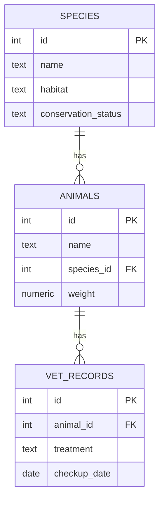
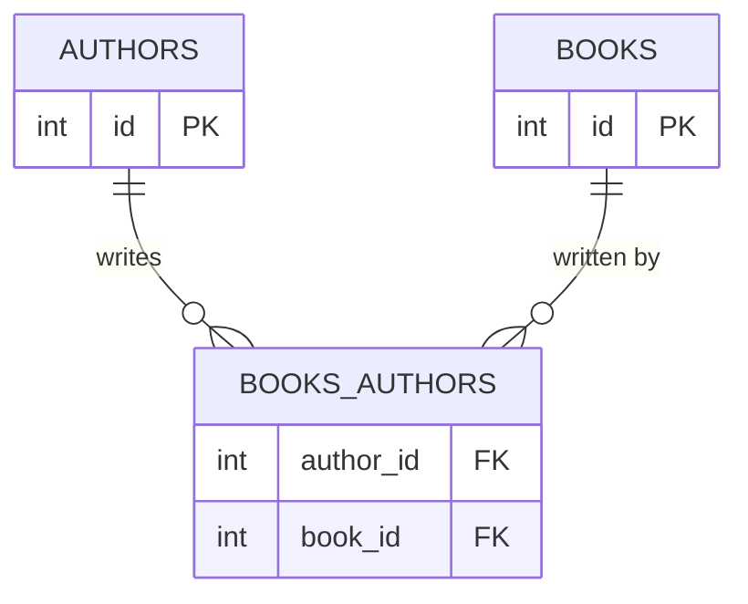

# Relational Databases, SQL, and PostgreSQL: Your Field Guide

Almost every real application stores data somewhere, and most of the time that somewhere is a relational database. Each concept below follows the same breakdown: **What it is**, **The Everyday Analogy**, **Why it matters**, and a **Quick Example**. Every major section ends with a Production Pitfall or Dev Tip.

## Table of Contents

1. [Relational Databases](#1-relational-databases)
2. [Common Databases and Installing PostgreSQL](#2-common-databases-and-installing-postgresql)
3. [SQL Basics: Databases and Tables](#3-sql-basics-databases-and-tables)
4. [Data Types](#4-data-types)
5. [Inserting, Viewing, Updating, and Deleting Data](#5-inserting-viewing-updating-and-deleting-data)
6. [Primary and Foreign Keys](#6-primary-and-foreign-keys)
7. [Changing a Schema: ALTER and Constraints](#7-changing-a-schema-alter-and-constraints)
8. [Relationship Types](#8-relationship-types)
9. [Joins](#9-joins)
10. [psql Command Reference](#10-psql-command-reference)
11. [Cheat Sheet](#11-cheat-sheet)
12. [Quick Check](#12-quick-check)

---

## 1. Relational Databases

### What it is

A **relational database** organizes data into **tables** made of **rows** and **columns**, and lets you **link tables together** through shared values.

- **Row (record):** One item, such as one user or one animal.
- **Column (attribute or field):** One property of that item, such as `name` or `weight`.
- **Schema:** The blueprint of the database: its tables, columns, data types, relationships, and constraints. Relational databases **require** a schema.
- **Primary key:** A unique ID for each row.
- **Foreign key:** A column that points at another table's primary key, which is how tables get linked.
- **Query:** A request for specific data ("which animals need a checkup?").

### The Everyday Analogy

Think of a **well-organized filing cabinet**. One drawer holds patient cards, another holds appointment slips. Each appointment slip carries a patient number instead of copying the patient's whole life story, so you can always walk from the slip to the right card.

### Why it matters

- **Integrity:** Keys and data types keep the data consistent and accurate.
- **Scalability:** Handles large datasets in real-world apps.
- **One query, many tables:** Relationships let you pull related data together in a single request.
- **Used everywhere:** healthcare, e-commerce, gaming, education, government, social media, and more.

### Quick Example: A Wildlife Conservation Centre

```text
species                animals                    vet_records
-------                -------                    -----------
id (PK)        <----   id (PK)             <----  id (PK)
name                   name                       animal_id (FK)
habitat                species_id (FK)            treatment
conservation_status    weight                     checkup_date
```

- `animals` is the **central table**.
- `animals.species_id` links to `species.id`.
- `vet_records.animal_id` links to `animals.id`.

An **ERD (Entity Relationship Diagram)** is a picture of exactly this. GitHub renders Mermaid diagrams, so you can draw one right in a README:



### Relational vs Non-Relational (NoSQL)

|                                | **Relational (SQL)**         | **Non-Relational (NoSQL)**                                |
| ------------------------------ | ---------------------------- | --------------------------------------------------------- |
| **Structure**                  | Tables with a strict schema  | Flexible, often schema-light (documents, key-value, etc.) |
| **Relationships**              | Linked through keys          | Usually not linked the same way                           |
| **Changing the shape of data** | Needs a schema change        | Add or remove fields freely                               |
| **Best for**                   | Structured data, consistency | Flexibility, fast-changing data                           |

> **Dev Tip:** "Relational vs NoSQL" is a trade-off, not a contest. Choose based on the nature of your data and what your app needs, and when in doubt for structured business data, start relational.

---

## 2. Common Databases and Installing PostgreSQL

### What it is

A **relational database management system (RDBMS)** is the software that stores your data and runs your queries. There are several popular ones.

### The Everyday Analogy

Different **brands of vehicles**. They all get you from A to B and follow the same traffic rules (SQL), but they differ in size, cost, and what jobs they suit.

### Why it matters

- Picking one affects hosting, tooling, and features.
- The skills transfer: SQL is broadly similar across all of them, but small details differ (like `SERIAL` in Postgres vs `AUTO_INCREMENT` in MySQL).

### Quick Example: The Main Players

| Database                 | Type              | Known for                                                                    |
| ------------------------ | ----------------- | ---------------------------------------------------------------------------- |
| **PostgreSQL**           | Free, open source | Reliability, data integrity, extensibility (custom data types and functions) |
| **MySQL**                | Free, open source | Very popular in web development, easy to use, big community                  |
| **SQLite**               | Free, open source | Lightweight, file-based, serverless, zero configuration                      |
| **Microsoft SQL Server** | Proprietary       | Microsoft ecosystem, enterprise use                                          |
| **Oracle Database**      | Commercial        | Large-scale enterprise performance                                           |

---

### Installing PostgreSQL

#### Windows (installer)

1. Go to **https://www.postgresql.org/**, click **Download**, choose your OS, then **Download the installer**.
2. Pick a version and run the installer. Click **Next** through the wizard:
   - **Install directory:** the default is fine.
   - **Components:**
     - **PostgreSQL Server:** the database engine itself.
     - **pgAdmin 4:** a friendly graphical management tool.
     - **Stack Builder:** downloads extra tools and extensions.
     - **Command Line Tools:** includes **`psql`**, the interactive terminal.
   - **Data directory:** the default is fine.
   - **Superuser password:** the superuser has unrestricted access to everything. **Remember this password.**
   - **Port:** the default is **5432**.
   - **Locale:** controls how locale-sensitive data is interpreted.
3. Review the summary, click **Next**, and wait a few minutes. You can cancel the Stack Builder prompt.

#### macOS (Homebrew)

```bash
brew install postgresql@<version>
# example
brew install postgresql@16
```

#### Linux (bonus, Debian/Ubuntu)

```bash
sudo apt update
sudo apt install postgresql postgresql-contrib
sudo systemctl start postgresql

# Open psql as the built-in postgres user
sudo -u postgres psql
```

### Using pgAdmin and psql

- **pgAdmin 4:** Search for it in your apps and open it. Click **Servers**, enter your superuser password, and browse your databases and tables visually.
- **psql:** Search for "psql" to open the SQL Shell, where you type commands directly.

> **Production Pitfall:** Never run your application as the **superuser**, and never reuse that install-time password anywhere real. Create a dedicated role per app with only the permissions it needs.

---

## 3. SQL Basics: Databases and Tables

### What SQL is

#### What it is

**SQL (Structured Query Language)** is the language for storing and managing data in relational databases. It was developed in the 1970s as **SEQUEL** (Structured English Query Language), later shortened to SQL.

#### The Everyday Analogy

Ordering at a restaurant. You do not walk into the kitchen. You use a **standard menu language** ("one pizza, no onions"), and the kitchen (the database) does the work.

#### Why it matters

- Add, change, delete, find, and retrieve data with a small set of commands.
- Query only what you need, which helps performance.
- An industry standard: portable and compatible across many databases.
- Works from nearly every programming language.

### Connecting with psql

```bash
psql -U <username> -d <database_name>

# A fresh install includes a default database named "postgres"
psql -U postgres -d postgres
```

The prompt shows where you are connected:

```text
postgres=#
```

### Creating and Connecting to a Database

```sql
CREATE DATABASE my_database;
```

```text
\c my_database
my_database=#
```

> **Remember:** SQL commands end with a **semicolon (`;`)**. Backslash commands like `\c` are **psql shortcuts, not SQL**, so they do **not** need a semicolon.

### Creating a Table

- **What it is:** `CREATE TABLE` defines a table: its name, its columns, and each column's data type.
- **Analogy:** Drawing the empty column headers on a spreadsheet before you type any rows.

```sql
-- General shape
CREATE TABLE table_name (
  column1 data_type column_constraint,
  column2 data_type column_constraint
);

-- A real one
CREATE TABLE products (
  id   SERIAL,
  name VARCHAR(255)
);
```

### Naming Conventions

- Use **snake_case** for tables and columns: lowercase words separated by underscores, like `delivery_orders`.
- By convention, write SQL **keywords in capitals** (`SELECT`, `CREATE TABLE`). It is not required, but it makes queries easier to read.

> **Dev Tip:** Stick to snake_case from day one. PostgreSQL folds unquoted names to lowercase, so `DeliveryOrders` quietly becomes `deliveryorders`, and mixed-case names later force you to quote them everywhere.

---

## 4. Data Types

### What it is

A **data type** tells the database what kind of value a column holds. Your goal is to choose the **most accurate** type for each column.

### The Everyday Analogy

Containers in a kitchen: a **measuring jug** for liquids, a **box** for dry goods, a **labeled jar** for spices. Using the right container prevents spills and mix-ups.

### Why it matters

- **Integrity:** The database rejects values that do not fit (no text in an integer column).
- **Storage and speed:** Right-sized types use less space.
- **Correctness:** The wrong type can cause subtle bugs, especially with money and dates.

### The Six Categories

**Numeric**, **date and time**, **character and string**, **Unicode** (e.g. `NVARCHAR`, mostly SQL Server), **binary** (images, audio, video), and **miscellaneous** (e.g. XML). Types vary between database systems, so check your database's documentation.

> **Postgres note:** `TEXT` and `VARCHAR` in PostgreSQL already store Unicode (UTF-8 by default), so you do not need separate Unicode types like `NVARCHAR`.

### Quick Example: The Most Useful Types in PostgreSQL

| Type                       | Use it for                                                          | Example                               |
| -------------------------- | ------------------------------------------------------------------- | ------------------------------------- |
| `INTEGER`                  | Whole numbers (4 bytes, about -2.1 billion to 2.1 billion)          | `units_sold INTEGER`                  |
| `SMALLINT` / `BIGINT`      | Smaller or bigger ranges than `INTEGER`                             | `views BIGINT`                        |
| `SERIAL`                   | Auto-incrementing ID (an `INTEGER`, not null, increments by itself) | `id SERIAL`                           |
| `NUMERIC(p, s)`            | **Exact** decimals, such as money                                   | `price NUMERIC(10, 2)`                |
| `VARCHAR(n)`               | Text with a maximum length                                          | `name VARCHAR(50)`                    |
| `TEXT`                     | Text of any length                                                  | `bio TEXT`                            |
| `DATE`                     | A calendar date                                                     | `event_date DATE`                     |
| `TIME`                     | A time of day                                                       | `start_time TIME`                     |
| `TIMESTAMP`                | Date and time                                                       | `event_timestamp TIMESTAMP`           |
| `TIMESTAMP WITH TIME ZONE` | Date, time, and time zone                                           | `created_at TIMESTAMP WITH TIME ZONE` |
| `BOOLEAN`                  | `TRUE` or `FALSE`                                                   | `is_active BOOLEAN`                   |

```sql
CREATE TABLE events (
  id              SERIAL PRIMARY KEY,
  title           VARCHAR(100) NOT NULL,
  ticket_price    NUMERIC(10, 2),
  event_date      DATE,
  start_time      TIME,
  created_at      TIMESTAMP WITH TIME ZONE,
  is_active       BOOLEAN
);
```

### `SERIAL` vs `AUTO_INCREMENT`

- **PostgreSQL:** `id SERIAL`
- **MySQL:** `id INT AUTO_INCREMENT`
- Same idea, different syntax between systems.

> **Bonus:** Modern PostgreSQL also supports the standard-SQL form `id INTEGER GENERATED ALWAYS AS IDENTITY`, which newer projects increasingly prefer over `SERIAL`. `SERIAL` still works and is what you will see in most tutorials.

> **Production Pitfall:** Store money in `NUMERIC(10, 2)`, **never** `FLOAT`, because floating-point numbers cannot represent values like 0.10 exactly and rounding errors creep into your totals.

---

## 5. Inserting, Viewing, Updating, and Deleting Data

These four operations are known as **CRUD**: **C**reate (`INSERT`), **R**ead (`SELECT`), **U**pdate (`UPDATE`), **D**elete (`DELETE`).

### Setup: The `dogs` Table

```sql
CREATE TABLE dogs (
  id   SERIAL,
  name VARCHAR(100),
  age  INTEGER
);
```

`id` is a `SERIAL`, so it starts at 1 and increments automatically. You do **not** supply a value for it.

---

### INSERT: Adding Data

#### What it is

`INSERT INTO` adds new rows to a table.

#### The Everyday Analogy

Writing a **new entry at the bottom of a logbook**, filling in each labeled field.

#### Why it matters

It is how data gets in. How you write it determines how safe it is.

#### Quick Example

```sql
-- BEST: name the columns explicitly
INSERT INTO dogs (name, age)
VALUES ('Gino', 3);

-- Multiple rows in one command
INSERT INTO dogs (name, age)
VALUES
  ('Gino', 3),
  ('Nora', 2);
```

- Text values go in **single quotes** (`'Gino'`).

```sql
-- RISKY: no column list
INSERT INTO dogs
VALUES ('Gino', 3);
-- Valid SQL, but values are assigned by column ORDER, so Postgres tries to put
-- 'Gino' into the id column and fails:
-- ERROR: invalid input syntax for type integer
```

> **Dev Tip:** Always list your columns in an `INSERT`. It survives later schema changes, and it is the difference between code that works and code that breaks the day someone adds a column.

---

### SELECT: Viewing Data

#### What it is

`SELECT` queries data from one or more tables.

#### The Everyday Analogy

Asking a librarian for **specific books**: all of them, only certain shelves, or only the ones that match your conditions.

#### Why it matters

Asking for only what you need keeps your app fast.

#### Quick Example

```sql
-- Everything (the * wildcard means "all columns")
SELECT * FROM dogs;

-- Specific columns
SELECT name, age FROM dogs;

-- Filter with WHERE
SELECT * FROM dogs WHERE age < 3;

-- Exact match
SELECT age FROM dogs WHERE name = 'Gino';

-- Sort results
SELECT * FROM dogs ORDER BY age;          -- ascending (default)
SELECT * FROM dogs ORDER BY age DESC;     -- descending
```

Sample output of `SELECT * FROM dogs;`:

```text
 id | name | age
----+------+-----
  1 | Gino |   3
  2 | Nora |   2
```

Comparison operators for `WHERE`: `=`, `<`, `>`, `<=`, `>=`, and `<>` (not equal).

---

### UPDATE and DELETE: Changing and Removing Data

```sql
-- Change existing rows
UPDATE dogs SET age = 4 WHERE name = 'Gino';

-- Remove rows
DELETE FROM dogs WHERE name = 'Nora';
```

> **Production Pitfall:** `UPDATE` or `DELETE` **without a `WHERE` clause** hits **every row** in the table. Write the `WHERE` first, and test it with a `SELECT` using the same condition before you run the change.

---

## 6. Primary and Foreign Keys

### Primary Key

#### What it is

A **primary key** is a column (or set of columns) that **uniquely identifies each row**. Values must be **unique** and **never `NULL`**, and a table can only have **one** primary key.

#### The Everyday Analogy

A **national ID number**. No two people share one, and everyone has one.

#### Why it matters

- Guarantees uniqueness and integrity.
- Speeds up data retrieval.
- Gives other tables something reliable to point at.

#### Quick Example

```sql
CREATE TABLE students (
  student_id SERIAL PRIMARY KEY,
  name       VARCHAR(100)
);
```

### Composite Primary Key

- **What it is:** A primary key made of **two or more columns** that are unique _together_.
- **Analogy:** A seat in a theatre is identified by **row and number together**. Seat 5 exists in every row, but row C seat 5 is unique.

```sql
CREATE TABLE course_enrollments (
  student_id INT,
  course_id  INT,
  PRIMARY KEY (student_id, course_id)   -- no trailing comma after this line
);
```

A student can take many courses and a course can have many students, but the same student can enroll in the same course only once, so the pair is unique.

> **Syntax note:** The original lesson example has a stray comma after the `PRIMARY KEY (...)` line. Remove it, because a trailing comma before the closing parenthesis is a syntax error.

---

### Foreign Key

#### What it is

A **foreign key** is a column that **references the primary key of another table**. A table can have many foreign keys. Values must either **match an existing primary key value** or be `NULL` (if allowed).

#### The Everyday Analogy

A **reference number on a delivery slip**. The slip does not contain the customer's whole profile, it just carries their customer number, and that number must exist in the customer records.

#### Why it matters

- Prevents **orphaned records** (an order pointing at a customer who does not exist).
- Creates the **relationships** that make a database "relational".

#### Quick Example

```sql
CREATE TABLE customers (
  customer_id SERIAL PRIMARY KEY,
  first_name  VARCHAR(100) NOT NULL
);

CREATE TABLE orders (
  order_id    SERIAL PRIMARY KEY,
  customer_id INTEGER,
  FOREIGN KEY (customer_id) REFERENCES customers(customer_id)
);
```

Shorter inline form:

```sql
CREATE TABLE orders (
  order_id    SERIAL PRIMARY KEY,
  customer_id INTEGER REFERENCES customers(customer_id)
);
```

Now this fails, because customer 999 does not exist:

```sql
INSERT INTO orders (customer_id) VALUES (999);
-- ERROR: insert or update on table "orders" violates foreign key constraint
```

### Bonus: Deleting Parent Rows

What happens when you delete a customer who still has orders? You choose the behavior:

```sql
customer_id INTEGER REFERENCES customers(customer_id) ON DELETE CASCADE
-- CASCADE: deleting the customer also deletes their orders
-- RESTRICT (default behavior): blocks the delete while orders exist
-- SET NULL: keeps the orders, sets customer_id to NULL
```

> **Dev Tip:** `ON DELETE CASCADE` is convenient but dangerous. For anything valuable (orders, invoices), prefer the default blocking behavior or "soft deletes" (an `is_deleted` flag).

---

## 7. Changing a Schema: ALTER and Constraints

### What it is

`ALTER TABLE` modifies a table that already exists. **Constraints** are rules the database enforces on your data (`NOT NULL`, `UNIQUE`, `PRIMARY KEY`, `FOREIGN KEY`).

### The Everyday Analogy

Renovating a house **while people live in it**. You can add a room or move a wall, but you have to be careful not to break what is already inside.

### Why it matters

Requirements change. Knowing how to evolve a schema safely is a core skill, and constraints keep bad data out at the source.

### Quick Example: Table and Column Operations

```sql
-- Create an empty table
CREATE TABLE first_table();

-- Add, rename, and drop columns
ALTER TABLE table_name ADD COLUMN column_name DATATYPE;
ALTER TABLE table_name RENAME COLUMN column_name TO new_name;
ALTER TABLE table_name DROP COLUMN column_name;

-- Drop a whole table
DROP TABLE table_name;

-- Rename or drop a database
ALTER DATABASE database_name RENAME TO new_database_name;
DROP DATABASE database_name;
```

### Quick Example: Constraints

```sql
-- NOT NULL: a value is required
column_name VARCHAR(50) NOT NULL

-- Add a column with a constraint
ALTER TABLE table_name ADD COLUMN column_name DATATYPE CONSTRAINT;

-- Add or remove constraints on an existing table
ALTER TABLE table_name ADD PRIMARY KEY (column_name);
ALTER TABLE table_name ADD UNIQUE (column_name);
ALTER TABLE table_name ALTER COLUMN column_name SET NOT NULL;
ALTER TABLE table_name DROP CONSTRAINT constraint_name;

-- Add a foreign key column in one go
ALTER TABLE table_name
  ADD COLUMN column_name DATATYPE
  REFERENCES referenced_table_name(referenced_column_name);
```

### Inserting `NULL`

```sql
INSERT INTO table_name (column_a) VALUES (NULL);   -- works only if column_a allows NULL
```

> **Bonus:** `NULL` means "unknown or missing", not zero or empty text. Test for it with `IS NULL` / `IS NOT NULL`, because `column = NULL` never matches anything.

> **Production Pitfall:** `DROP TABLE`, `DROP DATABASE`, and `DROP COLUMN` are **irreversible** without a backup. Double-check which database you are connected to (read the `psql` prompt) before running anything destructive.

---

## 8. Relationship Types

### What it is

Tables can relate to each other in five main ways.

### The Everyday Analogy

Relationships between people: a **passport** belongs to exactly one person (one-to-one), a **parent** has many children (one-to-many), **students and classes** overlap in both directions (many-to-many), and an **employee reporting to another employee** loops back within the same group (self-referencing).

### Why it matters

Choosing the right relationship decides **where the foreign key goes** and whether you need an extra table.

### Quick Example

| Type                 | Meaning                                                             | Example                                                | Where the FK lives                      |
| -------------------- | ------------------------------------------------------------------- | ------------------------------------------------------ | --------------------------------------- |
| **One-to-one**       | Each row matches at most one row in the other table, and vice versa | One employee has one vehicle (`employees`, `vehicles`) | Either side, with a `UNIQUE` constraint |
| **One-to-many**      | One row relates to many rows in another table                       | One customer has many orders (`customers` to `orders`) | On the **"many"** side                  |
| **Many-to-one**      | The same relationship viewed from the other side                    | Many orders belong to one customer                     | On the **"many"** side                  |
| **Many-to-many**     | Rows on both sides relate to many on the other                      | Authors and books                                      | In a **junction table**                 |
| **Self-referencing** | A table relates to itself                                           | Employees report to other employees                    | In the same table                       |

### Many-to-Many with a Junction Table

The relational model cannot express many-to-many directly. A **junction table** (also called a bridge or linking table) turns it into **two one-to-many relationships**.

```sql
CREATE TABLE authors (
  id   SERIAL PRIMARY KEY,
  name VARCHAR(100) NOT NULL
);

CREATE TABLE books (
  id    SERIAL PRIMARY KEY,
  title VARCHAR(200) NOT NULL
);

-- Named after both entities
CREATE TABLE books_authors (
  author_id INT REFERENCES authors(id),
  book_id   INT REFERENCES books(id),
  PRIMARY KEY (author_id, book_id)   -- prevents duplicate pairs
);
```



Now you can query all authors of a book, or all books by an author, and nothing is duplicated.

### Self-Referencing Example

```sql
CREATE TABLE employees (
  id         SERIAL PRIMARY KEY,
  name       VARCHAR(100) NOT NULL,
  manager_id INT REFERENCES employees(id)   -- points at another row in the SAME table
);
```

### One-to-One Example

```sql
CREATE TABLE vehicles (
  id          SERIAL PRIMARY KEY,
  plate       VARCHAR(20) NOT NULL,
  employee_id INT UNIQUE REFERENCES employees(id)   -- UNIQUE makes it one-to-one
);
```

> **Dev Tip:** In a one-to-many relationship, the foreign key always goes on the **"many"** side. If you catch yourself putting a list of IDs in one cell, you need a junction table instead.

---

## 9. Joins

### What it is

A **JOIN** combines rows from two or more tables based on a related column, so you can query across your normalized data in one go.

### The Everyday Analogy

**Matching name tags to guest list entries.** You hold the guest list in one hand and the dietary requirements sheet in the other, and you line up the rows that belong to the same person.

### Why it matters

- Data lives in separate tables on purpose, and joins are how you put it back together.
- Choosing the right join controls **which rows survive**, so it directly affects the correctness of your results.

### Setup: Sample Data

```sql
CREATE TABLE products (
  product_id   SERIAL PRIMARY KEY,
  product_name VARCHAR(100),
  category     VARCHAR(50),
  price        NUMERIC(10, 2),
  origin       VARCHAR(50)
);

CREATE TABLE sales (
  sale_id    SERIAL PRIMARY KEY,
  product_id INT REFERENCES products(product_id),
  quantity   INT,
  sale_date  DATE
);

INSERT INTO products (product_name, category, price, origin) VALUES
  ('Ice Cream',        'Food',      2.50,  'India'),
  ('Pizza Margherita', 'Food',      12.00, 'Italy'),
  ('Sushi',            'Food',      18.75, 'Japan'),
  ('T-Shirt',          'Clothing',  25.00, 'USA'),
  ('Jeans',            'Clothing',  60.00, 'Argentina'),
  ('Coffee',           'Beverages', 35.00, 'France'),
  ('Juice',            'Beverages', 5.00,  'Colombia');

INSERT INTO sales (product_id, quantity, sale_date) VALUES
  (1, 2,  '2025-07-18'),
  (2, 3,  '2025-02-13'),
  (6, 10, '2025-06-08'),
  (5, 8,  '2025-01-10'),
  (2, 1,  '2025-05-15');
```

Products **3 (Sushi), 4 (T-Shirt), and 7 (Juice)** have never been sold. Watch what each join does with them.

---

### INNER JOIN

- **What it is:** Only rows with a **match in both tables** (the intersection).
- **Analogy:** Only guests who are on **both** lists get in.

```sql
SELECT *
FROM products
INNER JOIN sales
  ON products.product_id = sales.product_id;
```

Result: only sold products (Ice Cream, Pizza twice, Jeans, Coffee). Unsold products are **excluded**. Notice that `product_id` appears **twice** in the output, once from each table.

### LEFT (OUTER) JOIN

- **What it is:** **All rows from the left table**, plus matching data from the right. No match means `NULL` for the right table's columns.
- **Analogy:** Read out the **whole guest list**, and note next to each name whether they paid, leaving it blank if not.

```sql
SELECT *
FROM products
LEFT JOIN sales
  ON products.product_id = sales.product_id;
```

Result: **every product**. Sushi, T-Shirt, and Juice appear with `NULL` in the sales columns.

### RIGHT (OUTER) JOIN

- **What it is:** The mirror image: **all rows from the right table**, matching data from the left.

```sql
SELECT *
FROM products
RIGHT JOIN sales
  ON products.product_id = sales.product_id;
```

Result: all 5 sales rows, each with its product details. Because every sale has a product, there are no `NULL`s here.

### FULL OUTER JOIN

- **What it is:** **All rows from both tables**. Matches are combined, and non-matches get `NULL` on the missing side.
- **Analogy:** Combine both lists completely, even the people who appear on only one.

```sql
SELECT *
FROM products
FULL OUTER JOIN sales
  ON products.product_id = sales.product_id;
```

> **Why the lesson's LEFT and FULL results look identical:** Every sale has a matching product, so the right table adds no unmatched rows. If `sales` contained a `product_id` that is missing from `products`, `FULL OUTER JOIN` would show that extra row but `LEFT JOIN` would not.

### SELF JOIN

- **What it is:** Join a table **to itself**, like two copies of the same table.
- **Analogy:** Looking up **each employee's boss** in the same staff directory.

```sql
SELECT e.name AS employee, m.name AS manager
FROM employees e
JOIN employees m ON e.manager_id = m.id;
```

### CROSS JOIN

- **What it is:** Every row of the first table paired with every row of the second (a **Cartesian product**). No `ON` condition.
- **Analogy:** Every shirt paired with every pair of trousers, to see all possible outfits.

```sql
SELECT *
FROM sizes
CROSS JOIN colors;
-- 3 sizes x 4 colors = 12 rows
```

### Joins at a Glance

| Join           | Keeps                  | Unmatched rows                |
| -------------- | ---------------------- | ----------------------------- |
| **INNER**      | Matches only           | Dropped                       |
| **LEFT**       | All left + matches     | Right columns become `NULL`   |
| **RIGHT**      | All right + matches    | Left columns become `NULL`    |
| **FULL OUTER** | Everything             | `NULL` on the missing side    |
| **SELF**       | Table joined to itself | Depends on the join type used |
| **CROSS**      | Every combination      | Not applicable (no condition) |

### Bonus: Find Rows With No Match

A very common real-world query: "which products have **never** sold?"

```sql
SELECT p.product_name
FROM products p
LEFT JOIN sales s ON p.product_id = s.product_id
WHERE s.sale_id IS NULL;
-- Sushi, T-Shirt, Juice
```

### Bonus: Pick Only the Columns You Need

Joining with `SELECT *` returns duplicate column names. Name your columns and use short aliases:

```sql
SELECT p.product_name, s.quantity, s.sale_date
FROM products p
INNER JOIN sales s ON p.product_id = s.product_id
ORDER BY s.sale_date;
```

> **Production Pitfall:** A `CROSS JOIN` (or a join with a missing or wrong `ON` condition) multiplies rows: two 10,000-row tables produce **100 million** rows. Always double-check your `ON` clause.

---

## 10. psql Command Reference

### What it is

`psql` is PostgreSQL's interactive terminal. Its **backslash commands** are shortcuts for the shell itself, not SQL, so they need **no semicolon**.

### The Everyday Analogy

The **control panel** around the engine: it does not change your data directly, it helps you navigate and inspect.

### Quick Example

```bash
# Log in (from your normal terminal)
psql --username=freecodecamp --dbname=postgres
```

| Command            | What it does                                                  |
| ------------------ | ------------------------------------------------------------- |
| `\l`               | List all databases                                            |
| `\c database_name` | Connect to a database                                         |
| `\d`               | List the tables (and other relations) in the current database |
| `\d table_name`    | Show the structure of one table                               |
| `\q`               | Quit psql                                                     |
| `\?`               | _(bonus)_ List all psql commands                              |
| `\dt`              | _(bonus)_ List **only tables**                                |
| `\x`               | _(bonus)_ Toggle expanded output for wide rows                |

```sql
CREATE DATABASE database_name;
\c database_name
```

> **Dev Tip:** The prompt is your seatbelt. `my_database=#` tells you which database you are about to change, so glance at it before every destructive command.

---

## 11. Cheat Sheet

| Task                          | Command                                        |
| ----------------------------- | ---------------------------------------------- |
| Create a database             | `CREATE DATABASE name;`                        |
| Connect                       | `\c name`                                      |
| Create a table                | `CREATE TABLE t (id SERIAL PRIMARY KEY, ...);` |
| Insert (safe form)            | `INSERT INTO t (a, b) VALUES (1, 2);`          |
| Read all                      | `SELECT * FROM t;`                             |
| Filter                        | `SELECT * FROM t WHERE age < 3;`               |
| Sort                          | `SELECT * FROM t ORDER BY col;`                |
| Update                        | `UPDATE t SET col = v WHERE cond;`             |
| Delete                        | `DELETE FROM t WHERE cond;`                    |
| Add column                    | `ALTER TABLE t ADD COLUMN c TYPE;`             |
| Rename column                 | `ALTER TABLE t RENAME COLUMN c TO d;`          |
| Drop column                   | `ALTER TABLE t DROP COLUMN c;`                 |
| Drop table                    | `DROP TABLE t;`                                |
| Require a value               | `col TYPE NOT NULL`                            |
| Add uniqueness                | `ALTER TABLE t ADD UNIQUE (col);`              |
| Primary key                   | `id SERIAL PRIMARY KEY`                        |
| Composite key                 | `PRIMARY KEY (a, b)`                           |
| Foreign key                   | `col INT REFERENCES other(id)`                 |
| Many-to-many                  | Junction table with two FKs and a composite PK |
| All matches only              | `INNER JOIN`                                   |
| All left rows                 | `LEFT JOIN`                                    |
| Find unmatched                | `LEFT JOIN ... WHERE right.id IS NULL`         |
| List DBs / tables / structure | `\l` / `\d` / `\d table`                       |
| Naming                        | `snake_case`                                   |

---

## 12. Quick Check

1. What is the difference between a primary key and a foreign key?
2. Why is `INSERT INTO dogs VALUES ('Gino', 3);` risky?
3. Which data type should you use for prices, and which should you avoid?
4. How do you model a many-to-many relationship between `books` and `authors`?
5. Which join returns every product, including ones that were never sold?
6. Why does `psql` not need a semicolon after `\c my_database`?
7. What happens if you run `DELETE FROM dogs;` with no `WHERE` clause?

<details>
<summary>Answers</summary>

1. A **primary key** uniquely identifies each row in its own table (unique, never `NULL`). A **foreign key** references another table's primary key to link the two.
2. Values are assigned by **column order**, so `'Gino'` goes into the `id` column and the insert fails. Always list the columns.
3. Use **`NUMERIC(p, s)`** for exact money values. Avoid **`FLOAT`**, which can introduce rounding errors.
4. With a **junction table** (e.g. `books_authors`) holding a foreign key to each table, ideally with a composite primary key.
5. **`LEFT JOIN`** from `products` to `sales` (a `FULL OUTER JOIN` also works).
6. `\c` is a **psql shortcut command**, not SQL, so it does not follow the semicolon rule.
7. It deletes **every row** in the table.

</details>

---

## Final Tips

- **Name your columns.** In `INSERT` and in `SELECT`, avoid relying on column order or `*` in production code.
- **Let the database enforce the rules.** Primary keys, foreign keys, `NOT NULL`, and `UNIQUE` catch bad data before it spreads.
- **Read the prompt, then run the command.** Check which database you are in before any `DROP`, `DELETE`, or `UPDATE`.
- **Practice:** Build the wildlife conservation schema from section 1 yourself (`species`, `animals`, `vet_records`), insert a few rows, and write a `JOIN` that lists each animal with its species and latest checkup.
