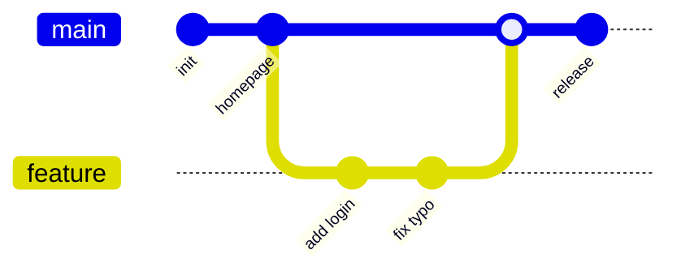
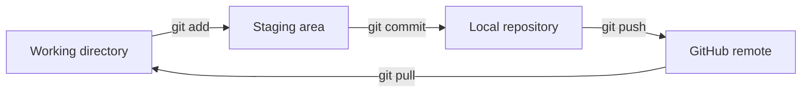
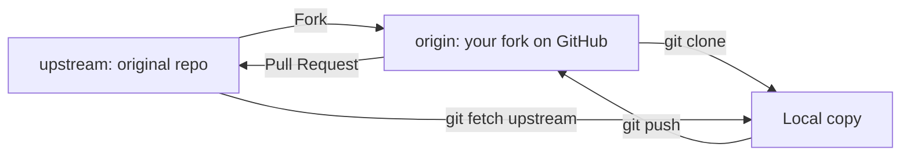
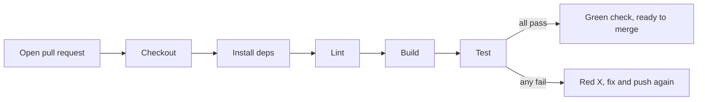

# Git, GitHub, and Nano: Your Field Guide

Version control is the safety net under every professional codebase. This guide starts with **Nano** (the editor you will meet when Git opens a terminal editor) and then covers Git, GitHub, branching, pull requests, code review, deployment, and CI/CD. Each concept follows the same breakdown: **What it is**, **The Everyday Analogy**, **Why it matters**, and a **Quick Example**. Every major section ends with a Production Pitfall or Dev Tip.

## Table of Contents

1. [Nano: Editing in the Terminal](#1-nano-editing-in-the-terminal)
2. [Version Control, Git, and GitHub](#2-version-control-git-and-github)
3. [Installing and Configuring Git](#3-installing-and-configuring-git)
4. [Repositories: Creating and Cloning](#4-repositories-creating-and-cloning)
5. [SSH and GPG Keys](#5-ssh-and-gpg-keys)
6. [Pushing a Local Project to GitHub](#6-pushing-a-local-project-to-github)
7. [Contributing to Other People's Repositories](#7-contributing-to-other-peoples-repositories)
8. [Branches](#8-branches)
9. [Pull Requests](#9-pull-requests)
10. [Code Reviews](#10-code-reviews)
11. [GitHub Pages](#11-github-pages)
12. [Staying in Sync with Upstream](#12-staying-in-sync-with-upstream)
13. [.gitignore](#13-gitignore)
14. [Branching Strategies](#14-branching-strategies)
15. [CI/CD and GitHub Actions](#15-cicd-and-github-actions)
16. [Cheat Sheet](#16-cheat-sheet)
17. [Quick Check](#17-quick-check)

---

## 1. Nano: Editing in the Terminal

### What it is

**Nano** is a small, beginner-friendly text editor that runs **inside the terminal**. It is useful when there is no graphical editor, for example on a remote server.

| Editor       | Learning curve                                         | Extensible?          |
| ------------ | ------------------------------------------------------ | -------------------- |
| **Vi / Vim** | Steep (many people cannot even figure out how to quit) | Yes, via plugins     |
| **Emacs**    | Moderate, with its own large shortcut set              | Yes                  |
| **Nano**     | Gentle, with on-screen help                            | No, rather barebones |

### The Everyday Analogy

**Notepad on a keyboard-only island.** It is not fancy, but it is always at hand and you can see the controls printed at the bottom of the screen.

### Why it matters

- Quick edits on **remote servers** with no GUI.
- Git can open it for **commit messages** if you configure it (`git config --global core.editor nano`).
- It shows its own shortcut list, so you do not have to memorize anything.

### Quick Example

```bash
nano notes.txt       # open (or create) a file
```

- **Top bar:** Nano version and file name.
- **Middle:** the file. Use arrow keys to move and type normally.
- **Bottom:** the shortcut list. `^` means hold **Ctrl**, and `M-` means hold **Alt** (the "meta" key).

| Action                        | Shortcut                                                                            |
| ----------------------------- | ----------------------------------------------------------------------------------- |
| **Save** ("Write Out")        | `Ctrl + O`, then **Enter** to confirm the file name                                 |
| **Cancel** the current prompt | `Ctrl + C`                                                                          |
| **Exit**                      | `Ctrl + X`                                                                          |
| Help                          | `Ctrl + G`                                                                          |
| Cut line / Paste              | `Ctrl + K` / `Ctrl + U`                                                             |
| Search ("Where Is")           | the key shown in your footer (`Ctrl + F` in newer builds, `Ctrl + W` in older ones) |
| Go to line                    | `Ctrl + /`                                                                          |
| Undo / Redo                   | `Alt + U` / `Alt + E`                                                               |

When you exit with unsaved changes, Nano asks:

```text
Save modified buffer (ANSWERING "No" WILL DESTROY CHANGES) ?
```

Press **Y** to save, **N** to discard, or **Ctrl + C** to cancel and keep editing.

> **Dev Tip:** The three keys to survive are **Ctrl + O** (save), **Ctrl + X** (exit), and **Ctrl + C** (cancel). Everything else is printed at the bottom of the screen.

---

## 2. Version Control, Git, and GitHub

### Version Control

#### What it is

A **version control system (VCS)** tracks and manages changes to your project over time. **Git** is the most popular one, with others such as SVN and Mercurial.

#### The Everyday Analogy

The `Thesis-Final`, `Thesis-Final-For-Real`, `Thesis-Absolute-Final-DO-NOT-CHANGE` problem, solved properly. Instead of many copies, you have **one project with a full, searchable history**, like the version history in Google Docs, but for code.

#### Why it matters

- **Undo:** go back to any earlier state or revert a bad change.
- **Compare:** see exactly what changed, when, and by whom.
- **Collaboration:** many people work at once without overwriting each other.
- **Safety:** experiment freely, because you can always get back.

### Commits and Branches

- **Commit:** A **snapshot** of your codebase at a point in time. **Analogy:** a save point in a video game, or a landmark along a road.
- **Branch:** A separate line of work. **Analogy:** a side road you can explore. If it goes well, you merge it back, and if not, you delete it without harming the main road.



### Git vs GitHub (and GitLab)

- **Git** is the **tool** on your computer that tracks history.
- **GitHub** and **GitLab** are **cloud services** that host Git repositories and add collaboration features.

| Benefit                               | What it gives you                                                                    |
| ------------------------------------- | ------------------------------------------------------------------------------------ |
| **Backup**                            | Your code lives in the cloud as well as on your machine                              |
| **Pull requests**                     | Teammates review changes in the browser, comment on lines, and suggest edits         |
| **Issue trackers and project boards** | Track bugs, assign tickets, plan sprints                                             |
| **Open source**                       | Anyone can view your code, propose changes, report issues, and run modified versions |
| **Closed source (private)**           | Only people you explicitly authorize can see the project                             |

> **Dev Tip:** Git works fully **without** GitHub. Use it on every project, even solo ones with no remote at all.

---

## 3. Installing and Configuring Git

### What it is

Before using Git you install it and tell it **who you are**, because every commit is stamped with your name and email.

### The Everyday Analogy

Signing the guest book. Every entry you write carries your name, so people know who made which change.

### Why it matters

- Commits without an identity are confusing or rejected.
- You configure it **once per computer**, not per project.

### Quick Example

**Check if Git is installed:**

```bash
git --version
```

**Install it:**

```bash
# Linux (Debian/Ubuntu)
sudo apt-get install git
# Linux (Arch)
sudo pacman -S git

# macOS (Homebrew)
brew install git

# Windows (Chocolatey, in PowerShell)
choco install git
```

On Windows you can also use the official installer from Git's website, and **Git Bash** gives you a Unix-like shell.

**Configure your identity:**

```bash
git config --global user.name "Jane Doe"
git config --global user.email janedoe@example.com
```

- `--global` applies to **all** projects. Run the command **without** it inside a project to override just that project.

**Choose your editor** (used when Git needs you to write a message):

```bash
git config --global core.editor nano
git config --global core.editor "code --wait"      # VS Code
```

On Windows, use the full path to the executable for other editors.

**View your settings:**

```bash
git config --list
git config --list --show-origin     # also shows which file each setting comes from
```

**Bonus:** Make new repositories start on `main`:

```bash
git config --global init.defaultBranch main
```

> **Production Pitfall:** Use the **same email as your GitHub account** (or GitHub's private `noreply` address), or your commits will not be linked to your profile.

---

## 4. Repositories: Creating and Cloning

### What it is

A **repository (repo)** is a **container for a project**: its files plus the complete history. A repo can be **local** (on your computer) or **remote** (on GitHub). You can start from either side and end up in the same place.

### The Everyday Analogy

A **project binder**: all the pages (files) and the full log of every edit, kept together.

### Why it matters

It is the unit you create, share, clone, and collaborate on.

### Creating a Repository on GitHub

1. Log in, click the **+** icon, and choose **New repository**.
2. Settings:
   - **Template:** a special repo you can use as a starting point (docs, issue templates).
   - **Owner:** your account or an organization.
   - **Name:** short and descriptive. Avoid spaces (GitHub swaps them for hyphens).
   - **Description:** optional, shown on the home page.
   - **Public or private:** public means anyone can view and download it. Private means only you and people you invite.
   - **Starter files:**
     - **README:** shown on the repo's home page, and the place to document your project.
     - **.gitignore:** files Git should not track (GitHub offers templates by language).
     - **License:** a legal document that says who may use your software and how.
3. Click **Create repository**.

### Cloning a Repository

Click the **Code** button on GitHub to get the clone URL.

| Method         | Notes                                                                                                                                                    |
| -------------- | -------------------------------------------------------------------------------------------------------------------------------------------------------- |
| **HTTPS**      | Works for public repos without logging in. Pushing or cloning private repos requires a **username and access token** (passwords are no longer accepted). |
| **SSH**        | Uses your **private and public keys**. More secure, and logs you in automatically with no token each time.                                               |
| **GitHub CLI** | `gh` does GitHub tasks from the terminal.                                                                                                                |

```bash
# SSH
git clone git@github.com:your-username/your-repository-name.git
cd your-repository-name

# GitHub CLI
gh repo clone your-username/your-repository-name

# Check the remotes (the link to the copy on GitHub)
git remote -v
```

### Creating a Repo with the GitHub CLI

```bash
gh repo create
```

With no arguments you get an **interactive wizard** with the same options as the website, and it can clone the new repo for you right away.

> **Dev Tip:** Always add a **README** and a **.gitignore** when you create a repo. A good README is the first thing anyone (including future you) will read.

---

## 5. SSH and GPG Keys

### What they are

Both use a **key pair**:

- **Private key:** stays on your machine, and is used to prove who you are. Never share it.
- **Public key:** shared with services (like GitHub), and used to **verify** you.

|                 | **SSH** (Secure SHell)                                                 | **GPG** (GNU Privacy Guard)                                                    |
| --------------- | ---------------------------------------------------------------------- | ------------------------------------------------------------------------------ |
| **Typical use** | **Authenticate** to a server or GitHub (and can also **sign commits**) | **Sign** files or commits so others can verify they are genuine and untampered |

### The Everyday Analogy

- **SSH key:** a **door key and lock**. You keep the key, and GitHub has the lock that only your key opens.
- **GPG signature:** a **wax seal** on a letter. Anyone can check the seal is yours and that the letter was not opened and changed.

### Why it matters

- Secure authentication without typing tokens.
- **Verified** commits get a badge on GitHub, proving the commit really came from you.

### Quick Example

**Generate keys** (both ask for a passphrase: optional but strongly recommended):

```bash
ssh-keygen -t ed25519 -C "your_email@example.com"
gpg --full-generate-key
```

**Find your keys:**

- SSH: files in `~/.ssh`. The public key ends in **`.pub`**, so you do not share the wrong one by accident.
- GPG: lives in a hidden, encrypted store, so list it:

```bash
gpg --list-secret-keys --keyid-format=long
gpg --armor --export "<key id>"        # prints the PUBLIC key to upload to GitHub
```

**Sign commits with GPG:**

```bash
git config --global user.signingkey <your_gpg_key_id>
git commit -S -m "signed commit"            # sign one commit
git config --global commit.gpgsign true     # sign every commit automatically
```

**Sign commits with SSH** (a newer GitHub feature; upload the key to GitHub first):

```bash
git config --global gpg.format ssh
git config --global user.signingkey <path_to_your_public_key>
git config --global commit.gpgsign true
```

> **Production Pitfall:** Upload only the **public** key (`.pub` or the `--export` output) to GitHub. If a private key is ever exposed, **revoke it immediately** and generate a new pair.

---

## 6. Pushing a Local Project to GitHub

### The Workflow



### Step 1: Create an Empty Repo on GitHub

Create a new repository **without** any files, so there is nothing to conflict with your local project.

### Step 2: `git init`: Start Tracking

```bash
cd super-awesome-game
git init
# Initialized empty Git repository in .../super-awesome-game/.git/
ls -a      # you will now see a hidden .git folder
```

- **Analogy:** `git init` puts a **hidden logbook** in the folder.
- The **`.git`** directory holds your whole history. **Do not delete it**, or all history is lost.

### Step 3: `git status`: See What Is Going On

```bash
git status
```

You will use this constantly. Sample output:

```text
On branch main
No commits yet
Untracked files:
	README.md
	index.html
```

### The Five File States

| State         | Meaning                                                           |
| ------------- | ----------------------------------------------------------------- |
| **Untracked** | New to the repo, and Git has not seen it before                   |
| **Modified**  | Existed in the last commit and has uncommitted changes            |
| **Ignored**   | Excluded from Git (usually via `.gitignore`)                      |
| **Deleted**   | Existed before and has been removed                               |
| **Renamed**   | Same contents, new name or location (small edits can still count) |

### Step 4: `git add`: Stage Changes

- **What it is:** The **staging area** holds what will go into your next commit.
- **Analogy:** Putting items in a **box before you seal and label it**.

```bash
git add index.html        # stage one file
git add .                 # stage everything in the current directory
git reset index.html      # unstage a file
```

Some developers warn against `git add .` because you might stage something you did not mean to. If you check `git status` first, you will be fine.

> **Modern alternative:** `git restore --staged <file>` also unstages a file and is easier to remember than `git reset`.

### Step 5: `git commit`: Take the Snapshot

```bash
git commit                                   # opens your configured editor
git commit -m "feat(api): implement JWT-based authentication"
```

Write **descriptive** messages. The style used in the lesson is **Conventional Commits** (`type(scope): description`):

```bash
git commit -m "feat(api): implement JWT-based authentication"
git commit -m "fix(auth): correct token expiration time"
git commit -m "refactor: simplify login flow logic"
```

After committing, `git status` shows:

```text
On branch main
nothing to commit, working tree clean
```

View history with:

```bash
git log
git log --oneline       # bonus: compact one line per commit
```

Each commit has an **author, date, message, and a commit hash** (a long unique ID).

### Step 6: `git remote add` and `git push`

```bash
git remote add origin git@github.com:your-github-username/name-of-repo.git
git push -u origin main
```

- `origin` is the conventional name for your main remote.
- `-u` is short for `--set-upstream`. It links your local `main` to `origin/main`, so from now on a plain `git push` is enough. You only need it **once per new branch**.

### Pulling Changes

```bash
git pull         # download and merge the latest changes from the remote
```

> **Dev Tip:** Make `git status` your reflex: before `add`, before `commit`, and after anything surprising.

---

## 7. Contributing to Other People's Repositories

### What it is

You usually do not have **write access** to someone else's project, so you make **your own copy** (a **fork**), work there, and propose your changes back.

### The Everyday Analogy

**Photocopying a recipe book** you do not own. You make notes in your copy, then send the author a note saying "here is an improvement, want to add it?"

### Why it matters

This is how open source works, and it is great practice for working on a professional team.

### The Flow



### Quick Example

1. **Fork:** click **Fork** on the repo page. Choose the owner and name, and keep **"copy only the main branch"** ticked unless you need another branch.
2. **Clone your fork:**

```bash
git clone git@github.com:your-username/repo-name.git
cd repo-name
```

3. **Check remotes.** Your fork is automatically named `origin`:

```bash
git remote -v
# origin  git@github.com:your-username/repo-name.git (fetch)
# origin  git@github.com:your-username/repo-name.git (push)
```

4. **Add the original repo as `upstream`** (the name is a convention):

```bash
git remote add upstream git@github.com:original-owner/repo-name.git
```

5. **Get the original's latest changes whenever you need them:**

```bash
git fetch upstream
git merge upstream/main
```

> **Note on the lesson's output:** The original notes list the second line of each remote as `(pull)`. Real Git prints **`(fetch)`** and **`(push)`**.

### The Basic Contribution Process

1. Read the **contributing documentation**.
2. Find an **issue** to work on (or open one to ask questions).
3. **Fork** the repo and **clone** your fork.
4. Create a **new branch**.
5. Make the changes.
6. Open a **pull request**.
7. Wait for **review**.

### What Is Open Source?

Projects whose source code is **public**, **modifiable**, and that **accept contributions**. Benefits: the community finds and fixes bugs, you learn from contributors, and you build a network. When you contribute you become an **open source contributor**, which is a great preview of professional team work.

> **Dev Tip:** If you are unsure how to contribute, read `CONTRIBUTING.md`, open an issue to ask, or join the project's Discord or community space. Do **not** open pull requests that only contain practice changes, because that is noise for maintainers.

---

## 8. Branches

### What it is

A **branch** is a separate workspace where you can change code **without affecting** `main`.

### The Everyday Analogy

**Main is a highway and each commit is a car.** A branch is an **exit ramp** where you can explore a new feature. If you like it, you merge back on to the highway. If not, you drive away and delete the ramp.

### Why it matters

- Keeps `main` **stable**.
- Lets you work on several tasks without tangling them together.
- Is **essential** when contributing to open source, because commits made directly to your fork's `main` cause divergent history later.

### Quick Example

```bash
git branch                    # list branches; * marks the one you are on
# * main

git branch feature            # create a branch
git checkout feature          # switch to it
git switch feature            # newer equivalent of checkout

git checkout -b feature       # create AND switch in one step
git switch -c feature         # newer equivalent
```

"Checking out" a branch loads the files **exactly as they were** on that branch. The new branch starts as a copy of where you were when you created it.

**A full mini workflow:**

```bash
git switch -c feature
echo "This is our new feature" > feature.md
git status                        # feature.md is untracked
git add feature.md
git commit -m "my new feature"
git push -u origin feature        # -u links local feature to origin/feature
```

### Merge Conflicts (Bonus)

When two branches change the **same part of the same file**, Git cannot decide which to keep, so it marks the conflict:

```text
<<<<<<< HEAD
const title = "Welcome";
=======
const title = "Hello";
>>>>>>> feature
```

Edit the file to keep what you want, remove the markers, then `git add` the file and `git commit`.

> **Production Pitfall:** Never commit directly to `main` when working from a fork. Always branch first, because cleaning up a polluted `main` is painful.

---

## 9. Pull Requests

### What it is

A **pull request (PR)** is a request to **pull your branch's changes into a target branch**. It is the standard way to propose code, and it gives maintainers a chance to **review** before merging.

### The Everyday Analogy

Handing in a **draft for editing** before it goes to print. The editor can comment, ask questions, request changes, and finally approve it.

### Why it matters

- Quality control: review, tests (CI), and discussion happen **before** code reaches `main`.
- It is the main collaboration workflow on GitHub.

### Creating a PR

1. Push your branch to GitHub.
2. Go to the **Pull requests** tab, then **New pull request** (GitHub also shows a banner after you push, as a shortcut).
3. Choose the branches:
   - **base:** the branch you want to merge **into** (usually `main`).
   - **compare** (also called the **head** branch): the branch with **your changes**.
4. Review the **commits** and the **diff** (a visual comparison of the changes: additions, deletions, modifications).
5. Click **Create pull request**, then fill in:
   - **Title:** auto-filled from your commit or branch name.
   - **Description:** often a **template** from the project. Fill it in, and follow the contributing guidelines.
   - On your own repo you can also set reviewers, assignees, labels, projects, and milestones.

"Compare across forks" lets you target the **original repo** instead of your fork.

### Merge Strategies

| Strategy             | What it does                                                             | History result                                     |
| -------------------- | ------------------------------------------------------------------------ | -------------------------------------------------- |
| **Merge** (default)  | Brings in all commits, plus **a merge commit**                           | Full history with a "Merge pull request #1" commit |
| **Squash and merge** | Combines **all commits into one** and adds it to the base                | Clean, linear, one commit per PR                   |
| **Rebase and merge** | Replays your commits **on top of** the latest base, with no merge commit | Linear history, original commits kept              |

Each project picks its own strategy.

### After the Merge: Update Your Local Repo

```bash
git checkout main
git pull
git log           # you will see your commit, and "Merge pull request #1" if the default merge was used
```

> **Dev Tip:** Review your own diff before you click "Create pull request". Catching a stray `console.log` yourself is much less awkward than having a maintainer find it.

---

## 10. Code Reviews

### What it is

A **code review** is when maintainers evaluate your PR, ask questions, request changes, and eventually approve it.

### The Everyday Analogy

A **proofreader and a test driver** working together: one reads your text carefully, the other takes the car for a spin.

### Why it matters

Reviews catch bugs, keep quality consistent, and teach you how real teams work.

### The Three Steps

1. **CI passes?** The automated checks (lint, tests, build) must succeed. If they fail, fix your PR using the reports.
2. **Review the code:** maintainers read the **diff** and may ask why you chose an approach.
3. **Try it locally:** they pull your changes, run the app, and verify nothing is broken.

### Approval and Merging

- A maintainer approves, sometimes with **"LGTM"** ("looks good to me").
- Some projects need **more than one approval** (freeCodeCamp needs two).
- Maintainers merge when ready.

### When Changes Are Requested

| Type                | Effect                                                                                         |
| ------------------- | ---------------------------------------------------------------------------------------------- |
| **Comment**         | A suggestion. You have freedom in how you implement it.                                        |
| **Request changes** | An official block on merging. The **same reviewer** must re-review after you make the changes. |

**Applying changes:**

- **Suggested edits:** GitHub shows a **button to commit the suggestion**. With many suggestions, go to the **Files changed** view, add them to a **batch**, and commit them all at once. This avoids many commits that each re-run CI.
- **Bigger changes:** make them locally, commit to the **same branch**, and push. The PR updates automatically.

```bash
git add .
git commit -m "address review feedback"
git push
```

### Tips for a Smooth Review

- **Be patient.** Maintainers are people with jobs. Do not ping repeatedly for a re-review.
- **Test before you submit.** Run the test suite and manually check your change.
- **Follow the project's contribution guidelines.**

> **Dev Tip:** Treat review feedback as free mentoring. Reply to each comment, even if only with "done", so the reviewer can see what changed.

---

## 11. GitHub Pages

### What it is

**GitHub Pages** hosts **static sites** (HTML, CSS, and JavaScript that run entirely in the browser, with no back-end server). It is free for open source projects.

### The Everyday Analogy

A **noticeboard** GitHub puts up for you. Whatever you pin to it (your files) is what visitors see.

### Why it matters

Free, fast deployment for portfolios, docs, and front-end projects, straight from the repo you already have.

### Quick Example

**A basic page** (`index.html`):

```html
<!DOCTYPE html>
<html>
  <head>
    <title>freeCodeCamp</title>
    <link rel="stylesheet" href="./style.css" />
  </head>
  <body>
    <h1>Welcome to freeCodeCamp's Lessons!</h1>
    <p>Let's have some fun learning about Git and GitHub!</p>
  </body>
</html>
```

**Deploy it:**

1. In the repo, open **Settings > Pages**.
2. Under source, keep **Deploy from a branch** (no framework or Actions needed).
3. Choose the branch (`main`) and the folder: `/ (root)` or `/docs`.
4. Click **Save**.

**Your URL:**

- Default: `https://<username>.github.io/<repo-name>/`
- You can add a **custom domain** in the same settings page.

**Updating:** Push to `main` and the site rebuilds automatically. It can take a few minutes, and you may need a **hard refresh** to bypass the cache.

You can also deploy CSS, JavaScript, and built framework output (React, Angular, and others).

> **Production Pitfall:** GitHub Pages only serves **static** files. If your app needs a server, a database, or secret keys at runtime, Pages is not the right host.

---

## 12. Staying in Sync with Upstream

### What it is

Keeping your **fork** up to date with the **original** repo.

### The Everyday Analogy

Your **photocopy of a recipe book** gets out of date when the original author adds new recipes. Syncing means getting the new pages into your copy.

### Why it matters

If you commit directly to `main` and the upstream accepts other changes, you end up with a **divergent history**: your `main` and the upstream `main` no longer line up, and syncing becomes a nightmare. This is the main reason to **always use branches**.

### Quick Example

```bash
git checkout main
git fetch upstream
git merge upstream/main
git push                 # update your fork (origin) on GitHub
```

- **`git fetch upstream`** downloads the latest changes **without** touching your branch.
- **Why not `git pull`?** Your local `main` is connected to `main` on **your fork** (`origin`), not on the original. A plain pull can behave unexpectedly.
- **`git merge upstream/main`** merges those changes into your current branch (`main`).

### When the Merge Fails: Hard Reset

If you accidentally committed to `main` and the histories diverged (and you have **not** opened a PR from `main`):

```bash
git reset --hard upstream/main
```

This forces your branch to **exactly match** `upstream/main`, discarding your local commits and changes on it.

If the push to your fork then fails because the remote history differs, you can force it:

```bash
git push --force
# safer alternative: refuses to overwrite commits you have not seen
git push --force-with-lease
```

> **Production Pitfall:** `reset --hard` and `push --force` **rewrite history and destroy work**. Check `git status` and `git log` first, and prefer `--force-with-lease`. Never force-push to a shared branch other people are using.

After syncing, **create your next branch from the freshly updated `main`**.

---

## 13. .gitignore

### What it is

A file named **`.gitignore`** that lists files and folders Git should **not track**. Technically, it tells Git not to start tracking matching untracked files.

### The Everyday Analogy

A **"do not pack" list** when moving house: things that stay behind, like personal documents, trash, and the equipment you will rebuild at the new place.

### Why it matters

- **Security:** keeps secrets out of your history.
- **Cleanliness:** avoids committing huge or generated folders.
- **Fewer conflicts:** personal editor and OS files do not clutter the repo.

### What Goes In It

| Category          | Why ignore                                                                  | Examples                                   |
| ----------------- | --------------------------------------------------------------------------- | ------------------------------------------ |
| **Secrets**       | Leaked keys are a security disaster. Treat even private repos as if public. | `.env`, `github.key`                       |
| **Dependencies**  | Huge, and reproducible from `package.json` plus a lockfile                  | `node_modules`                             |
| **Build outputs** | Reproducible by running the build, and they bloat history                   | `dist`, `coverage`, `.next`, `.angular`    |
| **IDE files**     | Local to your setup                                                         | `.vscode`, `.idea`                         |
| **System files**  | Personal metadata                                                           | `.DS_Store` (macOS), `Thumbs.db` (Windows) |

### Quick Example

```gitignore
# Secrets
.env
github.key

# Packages
node_modules

# Outputs
dist
*.js

# IDE
.vscode
!.vscode/settings.json

# System Files
.DS_Store
Thumbs.db
```

### Syntax Notes

- **`node_modules`** matches that name **anywhere** (including `client/node_modules`).
- **`/node_modules`** (leading slash) matches only at the **repository root**.
- **`*.js`** uses glob wildcards to match every `.js` file.
- **`!`** is **negation**: `!.vscode/settings.json` un-ignores that one file. (Note that a parent folder must not be fully ignored for the negation to work, so you often write `.vscode/*` rather than `.vscode`.)
- **`#`** starts a comment.
- Names are **case-sensitive on Linux**, so use the real name, `.DS_Store`.

> **Note on `*.js`:** In the lesson's TypeScript example, ignoring all `.js` files is intentional. In a normal project it would also hide config files such as `eslint.config.js`, so be careful with broad patterns.

### Ignoring Something Already Committed

Adding a path to `.gitignore` does **not** remove it from history or from tracking. To stop tracking a file that was committed earlier:

```bash
git rm -r --cached dist       # stop tracking, keep the files on disk
echo "dist" >> .gitignore
git add .gitignore
git commit -m "chore: stop tracking dist"
```

(The lesson describes deleting the files, committing, and then ignoring. `--cached` achieves the same result without deleting your local copy.)

**Important:** If a secret was ever committed, ignoring it is **not enough**. It remains in history, so **rotate (replace) the secret**.

### Templates

GitHub maintains ready-made `.gitignore` files for many languages and frameworks at **https://github.com/github/gitignore**.

> **Production Pitfall:** Add `.env` to `.gitignore` **before** your first commit. Once a key is pushed, assume it is compromised and rotate it.

---

## 14. Branching Strategies

### What it is

Team conventions for **when to branch, how to name branches, and how code flows to production**.

### The Everyday Analogy

**Lanes on a road** with clear rules: where to merge, who goes first, and what is allowed in the fast lane (`main`).

### Why it matters

- **`main` stays stable:** anyone should be able to pull it, build, run, and test.
- **Isolation:** unrelated changes do not get mixed, so bugs are easier to track down.
- **Clean context switching** between tasks.

### When to Branch

- Create a branch for **every isolated unit of work**: an OAuth feature, a password bug fix, and a profile redesign are three branches.
- **Always branch from `main`** (checkout `main` first). Branching from another feature branch drags its unfinished commits into your new work.

### Naming Conventions

| Pattern                                               | Example                            |
| ----------------------------------------------------- | ---------------------------------- |
| `scope/description`                                   | `feat/oauth-support`               |
| `scope/issue/description`                             | `fix/25/password-auth`             |
| `username/scope/description` (shared repos, no forks) | `naomi-lgbt/feat/profile-redesign` |

### Other Strategies

- **Feature flags** for long-lived work. The longer a branch stays unmerged, the more conflicts you will meet, so hide unfinished features behind a flag instead.
- **Deployment-environment branches:** freeCodeCamp uses `prod-staging` and `prod-current`. Merging `main` into them triggers deployments, so they can merge to `main` often without deploying every time.
- **Release branches** for each major version, so you can backport a security fix to an older release.
- **Merge through pull requests, not the local CLI.** This runs CI and gives you a final look at the diff.

> **Dev Tip:** One branch, one purpose. If your branch name needs the word "and", it is probably two branches.

---

## 15. CI/CD and GitHub Actions

### What it is

- **CI (Continuous Integration):** automatically **lint, build, and test** your code on every change.
- **CD (Continuous Delivery or Deployment):** automatically **deliver or deploy** the code once it passes.
- **GitHub Actions:** GitHub's built-in system for running these workflows on **ephemeral runners** (temporary computers), configured with **YAML** files.

### The Everyday Analogy

An **automated factory quality line**. Every product (pull request) passes through the same inspection stations (lint, build, test) before it is allowed on the shelf (`main`) or shipped (deployed).

### Why it matters

- Catches breakage **before** it reaches `main`.
- Everyone gets the same checks, so reviews focus on design instead of style or "does it even build?"
- Deployments become routine instead of risky.

**Where each runs:**

- **CI:** on pull requests, and on `main` to confirm it is deployable.
- **CD:** on `main` (continuous deployment), and optionally on PRs for **preview environments**.

### Quick Example: A CI Workflow

File location: **`.github/workflows/ci.yml`** (it must be in `.github/workflows`).

```yaml
name: Node.js CI
on:
  push:
    branches:
      - main
  pull_request:
    branches:
      - main

jobs:
  lint:
    name: Lint and Test
    runs-on: ubuntu-latest

    steps:
      - name: Checkout Source Files
        uses: actions/checkout@v4

      - name: Use Node.js v22
        uses: actions/setup-node@v4
        with:
          node-version: 22

      - name: Setup pnpm
        uses: pnpm/action-setup@v2
        with:
          version: 10

      - name: Install Dependencies
        run: pnpm install

      - name: Lint Source Files
        run: pnpm run lint

      - name: Verify Build
        run: pnpm run build

      - name: Run Tests
        run: pnpm run test
```

### How to Read It

| Key           | Meaning                                                                    |
| ------------- | -------------------------------------------------------------------------- |
| **`name`**    | The workflow's name, shown in PR status checks                             |
| **`on`**      | **Triggers**: here, pushes to `main` and PRs targeting `main`              |
| **`jobs`**    | The work to do. `lint:` is an internal key, and `name` is the display name |
| **`runs-on`** | The runner environment (`ubuntu-latest`)                                   |
| **`steps`**   | The ordered actions the job performs                                       |
| **`uses`**    | Run a **public, reusable action** (like `actions/checkout`)                |
| **`with`**    | **Arguments** passed to that action (like function parameters)             |
| **`run`**     | Run a **shell command**                                                    |

### Default Behavior

If a step fails, the **remaining steps are skipped** and the **whole run is marked as failed**.

### Sample Flow



> **Production Pitfall:** Never print or hard-code secrets in workflow files. Store them in **GitHub repository secrets** and reference them from the workflow. Also pin third-party actions to a version, as the example does with `@v4`.

---

## 16. Cheat Sheet

### Setup

| Task          | Command                                                                                     |
| ------------- | ------------------------------------------------------------------------------------------- |
| Check install | `git --version`                                                                             |
| Set identity  | `git config --global user.name "Name"` and `git config --global user.email you@example.com` |
| Set editor    | `git config --global core.editor nano`                                                      |
| View config   | `git config --list --show-origin`                                                           |

### Everyday Workflow

| Task             | Command                                               |
| ---------------- | ----------------------------------------------------- |
| Start a repo     | `git init`                                            |
| Clone            | `git clone <url>` or `gh repo clone owner/repo`       |
| Status           | `git status`                                          |
| Stage            | `git add <file>` or `git add .`                       |
| Unstage          | `git restore --staged <file>` (or `git reset <file>`) |
| Commit           | `git commit -m "feat: message"`                       |
| History          | `git log` or `git log --oneline`                      |
| Add remote       | `git remote add origin <url>`                         |
| List remotes     | `git remote -v`                                       |
| First push       | `git push -u origin main`                             |
| Later pushes     | `git push`                                            |
| Download changes | `git pull`                                            |

### Branches and Syncing

| Task                   | Command                                             |
| ---------------------- | --------------------------------------------------- |
| List branches          | `git branch`                                        |
| Create and switch      | `git switch -c name` (or `git checkout -b name`)    |
| Switch                 | `git switch name` (or `git checkout name`)          |
| Add upstream           | `git remote add upstream <url>`                     |
| Get upstream changes   | `git fetch upstream` then `git merge upstream/main` |
| Match upstream exactly | `git reset --hard upstream/main` (destructive)      |
| Force push (careful)   | `git push --force-with-lease`                       |

### Nano

| Action | Keys              |
| ------ | ----------------- |
| Save   | `Ctrl + O`, Enter |
| Exit   | `Ctrl + X`        |
| Cancel | `Ctrl + C`        |

### The Contribution Process

1. Read the contributing docs, 2. pick an issue, 3. fork, 4. clone, 5. create a branch, 6. make changes, 7. open a PR, 8. respond to review.

---

## 17. Quick Check

1. What is the difference between Git and GitHub?
2. What are the three places a change passes through before it reaches GitHub, and which command moves it between each?
3. Why use `git push -u origin main` the first time?
4. You forked a repo and committed straight to `main`. Why is that a problem?
5. Why use `git fetch upstream` and `git merge upstream/main` instead of `git pull` when syncing a fork?
6. You added `dist` to `.gitignore`, but Git still tracks it. Why, and what is the fix?
7. In a PR, what are the "base" and "compare" branches?
8. In a GitHub Actions file, what is the difference between `uses` and `run`?
9. In Nano, how do you save and exit?

<details>
<summary>Answers</summary>

1. **Git** is the version control tool on your computer. **GitHub** is a cloud service that hosts Git repos and adds collaboration features.
2. **Working directory, then staging area, then local repository** (then the remote): `git add`, then `git commit`, then `git push`.
3. `-u` (`--set-upstream`) links your local branch to the remote one, so later you can just run `git push`.
4. Your `main` ends up with commits the original repo does not have, creating a **divergent history** that makes syncing painful. Branch for every contribution.
5. Your local `main` tracks `main` on **your fork**, not on the original repo. Fetching and merging from `upstream` is explicit and predictable.
6. `.gitignore` only affects untracked files. Run `git rm -r --cached dist`, commit, and keep `dist` in `.gitignore`.
7. **Base** is the branch you want to merge **into** (e.g. `main`). **Compare** (the head branch) is the branch containing **your changes**.
8. `uses` runs a **reusable action** (like `actions/checkout@v4`). `run` runs a **shell command**.
9. `Ctrl + O` then Enter to save, and `Ctrl + X` to exit. If you exit with unsaved changes, press **Y** to save or **N** to discard.

</details>

---

## Final Tips

- **Small commits, clear messages.** Future you will read the log.
- **One branch per task, always branched from an up-to-date `main`.**
- **Never commit secrets.** Ignore them from day one, and rotate any that leak.
- **Be careful with destructive commands:** `reset --hard` and `push --force` can erase work.
- **Practice:** Fork a practice repo, add `upstream`, create `feat/your-name`, commit a small change, push, open a PR against your own fork, and merge it with each of the three strategies to see how the history differs.
